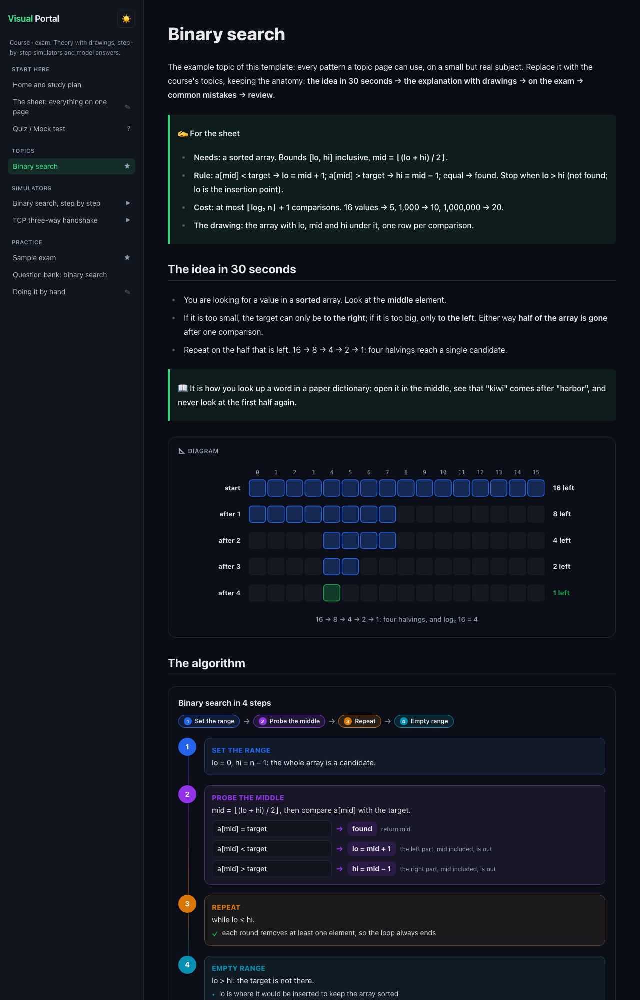
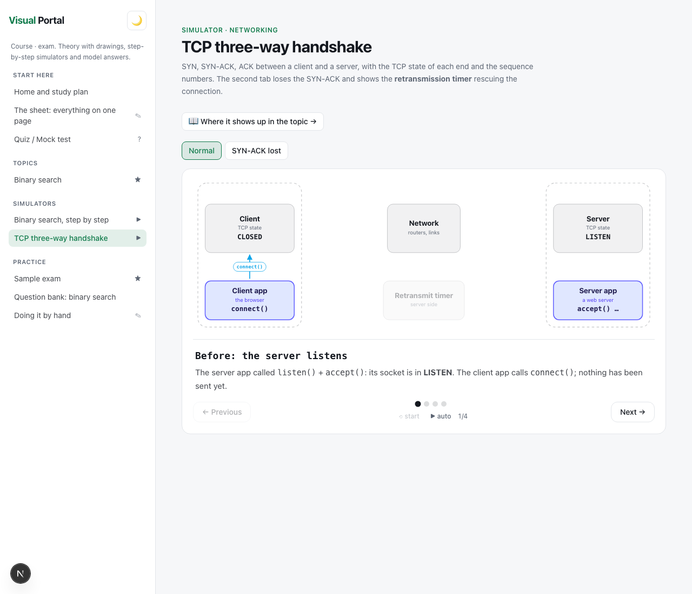

# Visual Learning Portal

**An agent skill for building visual-first educational websites.** Hand an AI coding agent your course material (slides, textbook chapters, past exams) and it builds a static study portal. Every idea in it is *drawn before it is written*: rendered diagrams, animated step-by-step simulators, worked "by hand" guides, solved past exams, a quiz and progress tracking.

<p align="center">
  
  
</p>

The approach was refined on real exam-prep portals that students studied from. It's written down so that any agent can do the same for any subject: algorithms, operating systems, networking, databases, physics, finance and so on.

## What's inside

```
skills/visual-learning-portal/
├── SKILL.md                 the workflow and the non-negotiables (entry point)
├── references/
│   ├── pedagogy.md          why the portal looks like this: picture → intuition → formula
│   ├── architecture.md      Next.js layout, content pipeline, markers, registries, exam mode
│   ├── visual-toolkit.md    which visual for which idea; diagram DSLs; Stage/Player/FlowSim
│   ├── engines-and-verification.md   pure engines, immutable steps, canonical checks
│   ├── content-authoring.md page anatomy for topics, guides, question banks and exams
│   ├── parallel-build.md    contract-first multi-agent build, one owner per file
│   └── quality-checklist.md what "done" means
└── template/                a working Next.js 16 starter with a complete example area
```

### The template
A domain-neutral, fully static portal (Next.js 16 · React 19 · TypeScript strict · Tailwind CSS v4 · react-markdown with KaTeX) that ships with:

- **Six diagram languages written in Markdown**: `steps`, `flow`, `sequence`, `tree`, `gantt` and `queues`. They're rendered as SVG and readable in light and dark mode, so no ASCII art is ever needed.
- **Step-by-step simulators**: SVG primitives in the style of lecture slides (`Stage`, `Box`, `Arrow` with animated packets), a keyboard-driven `Player`, and `FlowSim` for scenes described entirely as data.
- **Pure engines → immutable steps → UI replays them.** Simulators are correct by construction and testable without a browser.
- **Visual markers** like `[[vis:bsearch:basic]]` that embed simulators in Markdown, plus frozen snapshots (`:sheet`) for exam solutions.
- **Exam tooling**: past exams with collapsible solutions, a quiz with sources and best score, "✓ Studied" progress, and an **exam mode** that hides beyond-scope material without deleting it.
- **`npm run verify`** asserts every canonical result and checks content integrity: unknown visuals, broken links and anchors, ASCII diagrams, unbalanced markers.
- **Screenshot scripts** (desktop and 390 px mobile, dark and light) so the agent *looks* at what it built.
- An example area (binary search plus the TCP three-way handshake) that uses every pattern.

## Install

**As a Claude Code plugin:**
```
/plugin marketplace add mateo-khalil/visual-learning-portal
/plugin install visual-learning-portal@visual-learning-portal
```

**As a plain skill** (Claude Code, or any agent that reads `SKILL.md` folders):
```bash
git clone https://github.com/mateo-khalil/visual-learning-portal
cp -R visual-learning-portal/skills/visual-learning-portal ~/.claude/skills/
```
Copy it into a project's `.claude/skills/` instead to scope it to one repo.

## Use

Ask your agent something like:

> Build a visual study portal for my Operating Systems midterm. The slides are in `materials/`, and the past exams are `materials/exams/*.pdf`. Process scheduling and deadlocks are in scope; skip microkernels.

The skill walks the agent through it:
1. scope and an exam map;
2. scaffolding from the template;
3. choosing a visual per idea;
4. engines with checks;
5. content in the page anatomy;
6. `verify` + build + lint + screenshots.

## Try the template directly

```bash
cp -R skills/visual-learning-portal/template my-portal && cd my-portal
npm install
npm run dev        # http://localhost:3000
npm run verify     # → All OK
```

## License

MIT
